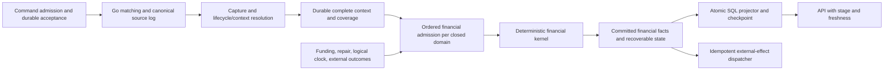

# Calcify single-server architecture pressure test — 2026-10-11

Measured follow-up: [aged capture/financial/SQL/recovery contention](CALCIFY_AGED_CONTENTION_PROOF_2026-10-11.md)
now completed. Final integrity passes,10k full-context gate fails; current proof
tightens recovery headroom and identity-state envelope. Offline results below
retain original scope and chronology.

**Verdict:** keep durable capture, deterministic financial ownership and replayable
commits. Change how bounded proofs become a runtime: use incremental keyed state,
separate correctness instrumentation from capacity measurement, and make backlog,
identity retention and shared-server resources explicit contracts. Evidence does
not justify replacing Kafka Streams or adopting a new financial database yet.

User constraints: **one server; larger server allowed if justified; hard 10,000/s
gate covers capture/context, with settlement allowed to lag.** This clarification
does not require 10,000 financially settled or SQL-visible trades/s. It also does
not permit unlimited lag on finite storage.

This is research and an implementation recommendation, not an accepted authority
ADR or a new throughput qualification. Frozen source:
`b9a8756e8d0efc5e8b665a5c62da1ab064d01539` (merged O1/PR485).
Concurrent O2 work exists in another worktree and is excluded from findings about
this baseline. Its files, broker and proof state were left untouched. Earlier
dated work-plan statements remain historical. D009 relational financial authority
remains accepted until a separate adoption decision.

## 1. Evidence and limits

Read current RFC, finite P3 contract, phase overview, standards, accepted decisions,
throughput/performance ledgers, focused O1 and financial checkpoints, original D7
result and original archived E4 measurement. Structural exploration used a fresh
`reef-calcify-stress-review` graph, generation `2026-10-11T16:34:40Z`, with cited
core source coverage checks and direct source inspection. Documentation/scripts
are outside that graph; coverage is best-effort, not an exhaustive code audit.

| Evidence | What it establishes | What it does not establish |
| --- | --- | --- |
| [D7 original result](../evidence/calcify-direct-throughput-2026-10-02/d7-300s-standing-liquidity/results.json) and [ledger](../THROUGHPUT_BASELINES.md#calcify-direct-path-d7-sustained-qualification-october-2-2026) | 300s standing-liquidity capture: 10,425.19 verified/s, 10,440.92 resolved/s; exact 3,142,846 unique timed trades | New lifecycle profile, no-reuse retention at millions of IDs, financial/SQL co-residency, 600s qualification |
| [E4 original measurement](https://github.com/dills122/reef-records/blob/2331d97d9f9e6af8638d6ed335adbfac743d2c03/records/reef/docs/evidence/calcify-financial-sprint1/sprint1-exit-2026-10-06-1c143125049d/arm5/proof/measurement.json) | At 60s, 63,104 settled = 1,051.73/s; eventually all 150,000 correct; 132.040s producer + 8.139s drain | A Kafka Streams ceiling, managed restart for this rate arm, or deployed financial capacity |
| [O1 checkpoint](../evidence/calcify-finite-p3/README.md) | Accepted finite lifecycle/capture model; semantic restore, replay membership and duplicate checks | High-rate source/capture runtime; live activation remains absent in frozen baseline |
| [New verification](../evidence/calcify-architecture-pressure-test/verification.json) | Five local kernel runs, one profile, serialization parity experiment, arithmetic/model checks | Broker, SQL, host-failure durability, multi-million-state operation or 10k qualification |

E4's preceding 4GiB resource failures are retained in its [focused checkpoint](../evidence/calcify-financial-sprint1/README.md#latest-empirical-checkpoint--october6-utc).
This review read that failure summary and original successful arm5 measurement;
it did not independently rerun or re-audit each earlier failure artifact.

## 2. Define the gate before selecting hardware

Recommended qualification contract, with numeric durations **proposed**, not
newly accepted SLOs:

* Count unique eligible economic executions with complete immutable context
  visible to a `read_committed` capture consumer by measurement deadline.
  Report offered, durably accepted, matched, captured and context-complete counts
  separately. Post-deadline drain never repairs deadline throughput.
* Keep standing liquidity as the comparable D7 reference. Run 10k/s for 600s,
  then 7.5k/s for 900s, matching RFC direction. Freeze warmup, seed exclusion,
  source profile, batch settings, host resources, initial state age and observers.
* Record source-to-context latency distribution and oldest incomplete source
  frontier. A throughput pass alone says nothing about a maximum freshness SLA;
  choose that SLA before product qualification.
* Settlement and SQL may lag. Record their frontiers, backlog bytes/age and drain
  rate without folding them into capture throughput. Exercise realistic
  settlement/SQL contention on the same server, including bounded restore.
* Additional stress arms: paired orders, modify/cancel/reject with zero trades,
  multi-fill outcomes, hot instrument/account domain, aged identities, retries,
  missing lifecycle dependencies and late publication acknowledgments. Label
  each workload; passing one does not certify all workloads at 10k/s.

D7 offered 10,500 aggressor commands/s against 64 excluded seed makers, using
16 lanes, 64 instruments, 1,024 workers and matching batch 500. A paired-order
workload may need about two new commands per trade; cancellations add source
work without adding trades. Report commands/s, executions/s, lifecycle members/s
and bytes/s together. Otherwise a successful trades/s number hides amplification.

## 3. Recommended architecture



All runtime components initially fit on one server. These are logical boundaries,
not a demand for a service per box. Capture does not wait synchronously for
financial decisions, SQL projection or external effects. New admissions must
respect a whole-pipeline retention budget so already accepted work remains
recoverable when downstream stops.

### Ownership and authority

1. Go owns matching order and source facts. Kotlin owns post-match orchestration
   and financial decisions. Reconstructing missing source facts from today's SQL
   state would break audit/replay and is not a recovery path.
2. A financial domain owns every account, asset balance, hold and obligation that
   can participate in its atomic mutations. Start with one isolated simulation
   run. Partitioning by instrument is unsafe when instruments share cash.
3. One ordered decision stream per domain includes funding, repair, time and
   external outcomes. Record enough admission order for replay. Seed-only
   simulator recomputation additionally needs deterministic observations/barriers.
4. Proposed log authority commits a complete financial result plus managed-state
   changes and consumed offsets atomically within Kafka. SQL receives committed
   results and advances its checkpoint in the same SQL transaction as all legs.
   Existing relational authority stays active for existing assigned runs.
5. Technical delivery identity, economic identity and action identity stay
   separate. Payload digest detects a conflicting retry; changing payload must
   not silently create a fresh action. Preserve the prior outcome.

Streams tasks derive from input partitions; adding threads does not parallelize a
single ordered hot domain. It also does not allocate a server's resources for us.
Use batching within that owner before adding partition complexity.
[Apache Streams architecture](https://kafka.apache.org/43/streams/architecture/)

### State layout: change representation before increasing finite limits

The finite [reducer/processor](../../services/platform-runtime/src/main/kotlin/com/reef/platform/calcify/FiniteLifecycleCaptureProcessor.kt)
validates complete state, reconstructs order/execution collections, retains
completed envelopes and checks certified history. Its processor loads and writes
one serialized state image. Appropriate bounded oracle; unsafe scale-up template.
Raising caps alone increases repeated validation and rewrite work with history.

Recommended runtime layout:

| State | Representation | Retention condition |
| --- | --- | --- |
| Accepted/order identities | Exact keyed membership and required facts | Retain until documented no-retry/no-reference frontier; no probabilistic membership as authority |
| Open source windows and unresolved members | Bounded keyed working set with ordered frontier | Release only after exact closure and durable downstream handoff |
| Completed capture/history | Immutable append log, keyed duplicate evidence where needed | Archive/prune only after all consumers and recovery requirements permit |
| Financial balances/holds/pending obligations | Incremental keys, bounded due index and cursor | Business lifecycle plus replay/checkpoint contract |
| Projection state | Rows plus per-domain sequence/digest/epoch checkpoint | Rebuildable from retained committed facts |

Validate each transition locally; run full semantic/history validation when
certifying or restoring a cut. Preserve exactly the O1 rejection and atomicity
rules in a differential oracle. Pruning remains a protocol: log truncation alone
does not prove a late reference or retry impossible.

An illustrative state that grows 128 bytes per event, rewritten after every event,
writes about 2.304PB of logical images over six million events, versus 768MB of
incremental additions. This is arithmetic, **not measured O1 traffic**. It explains
why representation is an architecture decision rather than a buffer-size tweak.

## 4. Findings that can invalidate capacity or correctness

### A. D7 and the new identity contract are materially different

D7 used terminal retention 3,906 per book (249,984 across 64 books). Matching
[`trackTerminalOrder`](../../services/matching-engine/internal/app/service.go)
releases terminal entries from the no-reuse index when evicted; associated tests
cover ID reuse. P0 instead pins terminal retention to zero and preserves no-reuse
identity for its finite run. Current guarantees are coherent in their own scopes.

**Consequence:** D7 does not establish memory, restore time or ID lookup behavior
for millions of unique orders under the new contract. A 10k/s 600s reference run
alone contains six million trades; the order population depends on workload.
Measure exact ID-index bytes, acceptance-store growth, snapshot size and replay
time at increasing state ages before buying more CPUs. Consider compact exact
tombstones or explicit order incarnations only if measured growth requires them;
incarnations change contracts and cannot be slipped into a capacity patch.

### B. Lag requires a bounded operating envelope

For constant arrival `λ`, financial service `μ`, burst duration `T`, initially empty
queue: `backlog = max(0, λ − μ) × T`. Drain after stopping input is `backlog / μ`.
These arithmetic scenarios use an **assumed 2,048 logical bytes per queued trade**;
they are not physical disk forecasts or measured financial capacities.

| Assumed service/s | Backlog after 600s at 10k/s | Logical queue GB | Drain after stop |
| ---: | ---: | ---: | ---: |
| 0 | 6,000,000 | 12.288 | Cannot drain |
| 1,051.73, historical E4 diagnostic | 5,368,960 | 10.996 | 85.08 min |
| 3,500 | 3,900,000 | 7.987 | 18.57 min |
| 7,500 | 1,500,000 | 3.072 | 3.33 min |
| 10,000 | 0 in this fluid model | 0 | No outage-recovery surplus |
| 12,000 | 0 in this fluid model | 0 | 2k/s recovery surplus |

At sustained `λ > μ`, finite storage eventually fills. If 10k is only a burst,
declare duration and duty cycle; at μ=7.5k, sustained duty fraction cannot exceed
75% in this simplified model. If 10k is continuous, require steady downstream
service above long-run arrivals, or a deliberate retention/admission policy.
Recovering a 60s outage within 300s while 10k/s continues requires 12k/s service.

E4 encoded 883,951,833 result bytes for 150,000 trades: 5,893 bytes/trade, or about
35.36GB for six million trades **for that result stream alone**. Add canonical
source, capture, changelogs, indexes, SQL/WAL, compaction overlap and snapshots.
Compression and retention change physical cost; multiply measured stage bytes,
not a guessed universal write-amplification factor.

Stop new work before reserve exhaustion, preserving capacity for every accepted
member's reachable closure, fetched suffix, funding/repair and recovery. Never
acknowledge 202 before durable ingress acknowledges. Never shed already accepted
history to keep a throughput graph flat.

### C. Single-host co-residency is an unproven resource boundary

D7 used a local RF1 broker, two broker CPUs/2GiB and disabled write caching;
receipt SQL and financial workload were absent. E4 used three RF3 brokers, each
one CPU/2GiB, and a shared producer/worker/observer JVM. Those configurations are
not comparable single-server capacity measurements.

Start qualification with one production-like broker and an honest single-host
failure model, unless another topology is required by a demonstrated contract.
Three colocated replicas do not survive host loss and consume shared disk/CPU.
Separate CPU, heap, native memory, file cache and disk budgets for matching,
capture, financial processing, broker and PostgreSQL. Leave measured compaction
and recovery reserve. A larger host helps only the saturated resource; more cores
alone will not fix a serial domain or synchronous disk waits.

Kafka's official memory guidance includes sharing RocksDB block cache and
`WriteBufferManager` across stores. Borrow that pattern and instrument total RSS;
heap caps do not bound native memory. Processor API caching can reduce store
writes without coalescing forwarded records, so count both.
[Kafka 4.3 memory management](https://kafka.apache.org/43/streams/developer-guide/memory-mgmt/)

Durable local acknowledgement is not off-host disaster recovery. Define the
recoverable archive/checkpoint cut, tolerated loss window and tested restore
location separately. Local storage must actually honor synchronization; software
settings cannot repair a device that lies about persistence.
[PostgreSQL WAL reliability](https://www.postgresql.org/docs/16/wal-reliability.html)

### D. Logical domain isolation does not guarantee progress isolation

An open transaction from domain A can hold a shared partition's last stable offset
before a later committed record from B. A `read_committed` consumer then cannot
see B yet. Independent domain IDs do not remove this coupling. Bound transaction
duration, watch log-end versus stable offsets, and test blocked A with healthy B
on both shared and separate partitions. Shared threads, processes and disk still
couple separate partitions. `max.poll.records` also does not bound fetched bytes;
oversized first batches complicate nominal fetch limits.
[Kafka consumer configuration](https://kafka.apache.org/43/generated/consumer_config.html)

The accompanying finite model demonstrates this ordering counterexample only;
it is not a live broker experiment. Redpanda also documents transaction visibility
and timeout/acknowledgment concerns. Pin and test deployed Redpanda `v26.2.4`
behavior; current documentation is not version-specific certification.
[Redpanda transactions](https://docs.redpanda.com/streaming/current/develop/transactions/)

### E. Recovery and upgrades need a versioned cut

The baseline pins Kafka clients/Streams 4.3.1. In 4.3, KIP-1035 places changelog
offsets in RocksDB, removes dependence on the old checkpoint file and disables
the RocksDB WAL. Low-traffic state may need extensive restoration after restart
because flushes need not follow every commit. Test this exact version at low
traffic, under sustained load, before/after flush, and with local state deleted.
Do not infer restart cost from an older version's checkpoint behavior.
[Kafka 4.3 memory management](https://kafka.apache.org/43/streams/developer-guide/memory-mgmt/)

[KAFKA-20685](https://issues.apache.org/jira/browse/KAFKA-20685) documents a
version-specific crash/restore issue fixed in 4.1.3/4.2.2. It is a warning to test
the pinned adapter, **not evidence that Reef 4.3.1 has that issue**.

A certificate should bind source/topic identity and partition offset vector,
admission frontier, owner epoch, state/history digest, staged dependencies,
kernel/policy/schema versions and compatible decoder. A cut spanning colocated
domains must be consistent across their partitions. Independently choosing each
domain's newest snapshot is not sufficient.

Upgrade proof: replay old commits under their declared schema, restore the cut,
apply a recorded migration if needed, then admit new actions under the new policy.
Replay must not dispatch external effects. After committed financial mutations,
rollback requires fencing and compatible recovery, not rerouting accounts to an
old writer with stale balances.

### F. Publication uncertainty and financial insufficiency are different states

Unknown publication outcome means reconcile the existing stable identity before
resubmitting, including after process death or ownership transfer. Test an old
writer's late acknowledgment after a new writer acquires its epoch. Capacity
permits must survive this ambiguity without double spending or leaking forever.

Insufficient funds are a valid business outcome or pending obligation, not a
poison message to skip or an infrastructure failure to retry blindly. Repeated
funding/repair must follow the same deterministic admission path as normal work.
Reserve control capacity so exhausted new-trade capacity cannot prevent recovery.

Persisting the transfer identity before first submission and reusing it through
recovery is an established ledger pattern. Calcify needs the same discipline for
its own command/action identities, including result lookup and conflicting payloads.
[TigerBeetle reliable submission](https://docs.tigerbeetle.com/coding/reliable-transaction-submission/)

### G. SQL visibility is a separate atomicity contract

Project a complete financial bundle, unique action/result identity and next
checkpoint in one SQL transaction. A duplicate with the same digest is harmless;
a different digest is an integrity fault. Refuse sequence gaps and stale owner
epochs. Make crash-before-commit and lost-commit-response tests explicit.

An API reading balances and freshness in separate READ COMMITTED statements can
see different snapshots. Use one query or an appropriate common transaction
snapshot. Expose capture/financial/projection stages rather than implying that
captured means settled. A simulator using SQL observations needs a recorded
frontier/barrier if seed-only replay is promised.
[PostgreSQL isolation](https://www.postgresql.org/docs/16/transaction-iso.html)

Kafka EOS covers participating Kafka reads, state and outputs; it does not make
PostgreSQL or an external payment call atomic with them. External dispatch needs
a stable effect key, persisted outcome and reconciliation of unknown outcomes.
[Streams processing guarantees](https://kafka.apache.org/43/streams/core-concepts/)

## 5. New experiment: diagnose the kernel before blaming its adapter

Added [offline probe](../../scripts/dev/calcify-financial/research/run-kernel-probe.mjs)
that compiles the existing test-only `FinancialKernel.kt` unchanged for the
baseline. Java21, Kotlin2.4.20, Jackson2.22.3; runtime heap768MiB; 2,000 warmup
trades, then four 10,000-trade arms: no result encoding, encoding, encoding,
no encoding. Timed work includes constructing actions, capture, settlement and
optional result encoding. One hot buyer/seller domain; no broker or SQL.

Seven checks cover funded settlement, duplicate without extra history, exact
replay, checkpoint restore, zero legs on insufficient cash, changed-retry conflict
and corrupt-history rejection. Each arm separately checks final economics.

| Run, in execution order | Variant | Four arm rates, trades/s |
| --- | --- | --- |
| 01 | Baseline, initial harness | 3,435 / 3,394 / 3,468 / 3,577 |
| 02 | Baseline, added final history checksum | 3,531 / 3,258 / 3,374 / 3,572 |
| 03 | Streaming canonical encoder in scratch copy | 4,544 / 4,899 / 5,546 / 6,043 |
| 04 | Streaming, added 1,000-case canonical corpus | 5,993 / 5,497 / 5,533 / 6,161 |
| 05 | Baseline, same latest corpus/harness | 3,449 / 3,342 / 3,372 / 3,556 |

A separate 14s JFR diagnostic of initial baseline recorded 770 execution samples;
274 had canonical encoding or its lambda as nearest kernel frame. Another 421
had no kernel frame. This supports a serialization hypothesis, not a precise
CPU attribution or proof of the E4 bottleneck.

The isolated candidate uses one Jackson generator per canonical root instead of
recursively creating serialization machinery for each scalar/key. Production and
test kernel source remain unchanged; substitution occurs only in a fresh output
directory. Runs04/05 encoded arms were about **5.50–5.53k versus 3.34–3.37k/s**.
Both produced the same final history checksum, the same 53,532,284 result bytes
excluding genesis, and the same digest across a 1,000-case corpus of escaped
strings, Unicode, large integers, decimals and nested values. All seven checks
passed. Exact digests and all run results are in the verification receipt.

**Decision supported:** production representation deserves a focused optimization
and compatibility proof before a framework pivot. **Not supported:** a 1.64x
production gain, lower bounded memory, or 10k financial capacity. Runs were
sequential on a shared local host, with visible warmup/order effects; sampled heap
is neither a comparative live-set measurement nor a hard bound. Full malformed
input, schema evolution, property and managed-crash suites remain prerequisites
before adopting the encoder.

Do not replace financial identity/checksums with raw serialized protobuf hashes.
Deterministic protobuf serialization is not canonical across builds/schema
changes. Specify fields and encoding for each versioned business digest.
[Protobuf serialization guidance](https://protobuf.dev/programming-guides/serialization-not-canonical/)

## 6. What to borrow from established systems

| Primary source | Concrete adoption | Boundary |
| --- | --- | --- |
| [LMAX Disruptor paper](https://lmax-exchange.github.io/disruptor/disruptor.html) | Single-writer ownership, batching, allocation-aware hot path | No automatic Disruptor/Aeron rewrite; historical benchmark rates do not transfer |
| [TigerBeetle performance guidance](https://tigerbeetle.com/blog/2026-09-17-performant-use-of-tigerbeetle/) | Batch meaningful ledger operations; measure data model and client pipeline | Vendor benchmark is not Reef capacity |
| [Linked events](https://docs.tigerbeetle.com/coding/linked-events/) and [currency exchange recipe](https://docs.tigerbeetle.com/coding/recipes/currency-exchange/) | Atomic cash/security legs with explicit correlation and balanced ledgers | Atomic linked transfers do not implement source closure, order lifecycle or SQL projection |
| [Two-phase transfers](https://docs.tigerbeetle.com/coding/two-phase-transfers/) | Explicit reservation lifecycle, one-time post/void identities | Partial posting releases remaining pending amount; Calcify residual order holds need different handling |
| [Correcting transfers](https://docs.tigerbeetle.com/coding/recipes/correcting-transfers/) | Immutable compensating entries linked to original | Never erase an economic fact to repair a projection |
| [Jepsen TigerBeetle analysis](https://jepsen.io/analyses/tigerbeetle-0.16.11) | Check claimed total order, then replay independent operation semantics; retain uncertain outcomes | Study covers stated historical versions, not a current product guarantee |
| [FoundationDB simulation testing](https://apple.github.io/foundationdb/testing.html) | Inject disk/network/clock/failure schedules around real state transitions; persist failing seeds and shrink traces | Simulation supplements actual broker/process/storage tests |
| [PostgreSQL locking](https://www.postgresql.org/docs/16/explicit-locking.html) and [bulk loading](https://www.postgresql.org/docs/16/populate.html) | Stable account lock order, bounded transactions, batching to amortize commits | Do not remove ledger constraints or durability to win a benchmark |

Reservation example to freeze before P1b: cash100, hold80, settle50 for that order
should leave cash50, hold30 and unrelated available cash20 under a continuing
order-hold policy. Partially posting a TigerBeetle pending transfer instead
releases its unposted remainder. Copying that API's shape without adapting its
semantics would change availability. Keep gross unreserved P1a explicit until
reservation ownership, amend/cancel, partial fill and failure rules are accepted.

DTCC CNS nets member/security positions and has explicit acceptance, novation,
guarantee, fail and partial-settlement semantics. Netting can reduce settlement
legs; it cannot remove executed-trade evidence, and it is not a free performance
switch for a gross-settlement model.
[DTCC CNS](https://www.dtcc.com/products-and-services/clearing-settlement-services/equities-clearing/cns)

Keep internal simulated finality distinct from external finality. PFMI principles
8 and 12 are useful design references for explicit finality and conditioning
linked obligations; they do not certify this simulator as a regulated settlement
system. External reversals, fees, calendars and rounding require explicit later
policies rather than inferred meanings of status names.
[BIS PFMI](https://www.bis.org/committees/cpmi/pfmi/overview)

## 7. Authority options and pivot criteria

| Option | Fit now | Evidence required before changing direction |
| --- | --- | --- |
| Kafka Streams plus committed financial log | Best continuation: existing capture stack and financial recovery proofs; single ordered owner fits | Production-shaped keyed state, bounded native memory, actual restart and co-resident capacity |
| PostgreSQL financial authority with ordered admission/outbox | Credible simpler single-host alternative; accepted relational baseline already exists | Same inputs, decisions, invariants, durability and failure oracle; measure total host cost and delivery complexity |
| TigerBeetle financial subsystem | Strong ledger patterns; additional adapter and operating model | Justified deployment model and semantics; its recommended production cluster has six replicas on separate machines/disks |
| New custom WAL, Aeron/Disruptor runtime, workflow/stream framework | No present evidence that replacement cost is warranted | Diagnosed limitation that cannot be fixed within current architecture, plus migration/recovery proof |

TigerBeetle's production deployment guidance conflicts with the current
single-server constraint; a development single-node experiment would not remove
that gap. [Cluster guidance](https://docs.tigerbeetle.com/operating/cluster/)

Do not run a broad framework bake-off now. First measure a lean adapter using the
same financial decisions. Compare PostgreSQL only if the measured resource budget
or implementation burden is unacceptable. Compare whole pipeline CPU, storage,
recovery and operational code, not only isolated transactions/s. Choose one
authority per assigned domain; dual writable ledgers are not a migration tactic.

## 8. Why implementation has accumulated friction

Much of the difficulty comes from mixing distinct jobs in one proof surface:
source lifecycle correctness, durable publication evidence, financial decisions,
restoration, forensic verification and rate measurement. Those are necessary
obligations, but they need not all execute on the same timed thread/JVM.

E4 emitted 5,550,017 state/history/coverage/certificate writes for 150,000 trades,
about37 writes/trade in that harness. Its ACK journal used four force operations
per batch across3,146 batches, with60.525s summed force duration. Producer elapsed
132.040s; producer, worker and observer shared JVM resources. These observations
identify candidate overheads. They do **not** permit subtracting force time from
wall time or assigning the rate miss solely to Kafka, disk or the kernel.

Keep an intentionally exhaustive, small correctness oracle. Build capacity
measurement around the real adapter with streaming counts/digests, bounded
observation and independent post-run verification. Required durable admission
evidence stays durable; move incidental test copies and oracle materialization
off the hot path. Measure the observer's own CPU/I/O and prove that disabling
optional observation does not change decisions.

The finite P0 allowance of16 publications ×8 trades/outcome yields at most128
trades before other limits, only12.8ms at10k/s. The accepted tiny O1 fixture
expanded source payload from16,647 to24,797 bytes and added29,930 capture bytes
for three trades. These expose scope/amplification questions, not representative
production bytes/trade. Keep finite acceptance separate from rate qualification.

## 9. Proof sequence and decision register

The next useful implementation slice is **O2 live admission/capture with its
existing finite correctness limits, paired with a separate scalable-state and
co-residency capacity track**. Incorporate concurrent O2 work when reviewing its
actual branch; do not reopen accepted O1 or silently enlarge its contract.

| Step | Experiment and required observation | Decision unlocked |
| --- | --- | --- |
| 1 | Freeze source/workload/version/host manifest and capture-only measurement contract; declare finite burst versus continuous load | Comparable 10k gate and sizing basis |
| 2 | Age exact identity/context state through increasing populations toward target run size; record bytes/key, lookup latency, checkpoint/replay time | Keep representation or implement compact exact keyed state |
| 3 | Differentially drive incremental reducer against finite oracle: reorder, duplicate, corrupt, missing member, closure burst, invalid restored history | Production state layout without weakening O1 semantics |
| 4 | Small live adapter crash matrix: lost ack, old-owner late ack, SIGKILL around transaction commit, cold/warm restore, low-rate unflushed store, disk pressure | Actual pinned-version durability/recovery boundary |
| 5 | Same-host capture at60s diagnostic, then proposed600s qualification; financial consumer stopped, running and restoring; SQL projector running | Storage envelope, CPU/native-memory/disk budgets and host justification |
| 6 | One full financial bundle through atomic SQL/read seam; force duplicate delivery, sequence gap, commit-response loss and stale epoch | Correct user-visible financial state and freshness |
| 7 | If measured cost remains unacceptable, bounded Streams/PG adapter comparison with same admitted log and independent economics oracle | Evidence-backed authority choice |

Correctness failure stops rate tuning. Each experiment has one hypothesis, frozen
inputs, negative control and durable compact result. A resource increase needs a
measured bottleneck and estimated headroom; a passing short diagnostic advances
to qualification, it does not replace it.

| Open decision | Proposed default | Falsifier / evidence still needed |
| --- | --- | --- |
| Financial ownership | One closed run domain, single writer | Shared resources across runs or unacceptable measured hot-domain service |
| Capture vs settlement gate | Capture/context10k; distinct settlement/freshness envelope | Product requirement for synchronously settled observations |
| Source closure | Ordered bounded windows with reserved reachable closure | Worst-case multi-fill/fetched-suffix proof cannot close within cap |
| History vs working state | Append facts, incremental exact state, certified pruning | Required late reference outlives planned retention |
| Encoder | Prototype streaming canonical form for compatibility work | Any differing canonical bytes, digest, decision or recovery behavior |
| Runtime authority | Continue managed-log candidate, preserve D009 meanwhile | Total single-host cost or correctness complexity favors measured PG alternative |
| Reservation/netting | Gross unreserved P1a; defer semantic extension | Accepted trading/risk profile requires holds or netting |
| Host size | Choose after co-resident measurement; larger allowed | CPU versus disk/native-state diagnosis, declared recovery reserve |

Unresolved numeric values: maximum run length/order population, continuous versus
burst duty cycle, tolerated settlement age, retention/archive window, recovery
time/loss targets, capture freshness and hardware ceiling. This review supplies
their equations and falsifying tests; it does not invent accepted SLOs. These
values should be frozen before capacity qualification, while finite correctness
implementation can proceed.

## 10. Reproduce and retain

```sh
bun scripts/dev/calcify-financial/research/budget-model.mjs
bun scripts/dev/calcify-financial/research/run-kernel-probe.mjs /private/tmp/calcify-kernel-baseline-new /Library/Java/JavaVirtualMachines/jdk-21.jdk/Contents/Home/bin/java 10000 baseline
bun scripts/dev/calcify-financial/research/run-kernel-probe.mjs /private/tmp/calcify-kernel-streaming-new /Library/Java/JavaVirtualMachines/jdk-21.jdk/Contents/Home/bin/java 10000 streaming
```

Use an available Java21 path on another host. Runner requires the pinned artifacts
already in Gradle cache, makes no network calls and refuses an existing output
directory. It writes compiler/runtime status, dependency/source hashes and result.
Budget model checks5,239 finite queue recurrences plus head-of-line/control and
headroom examples. It is arithmetic and a toy visibility model, not model checking
of the production distributed system.

All five attempt results, harness revisions, dependency hashes, canonical parity
and aggregate profile evidence are preserved in compact
[verification](../evidence/calcify-architecture-pressure-test/verification.json).
Scratch logs/classes remain in `/private/tmp/calcify-architecture-kernel-01`
through `-05`; these are ephemeral, not the repository's evidence authority.
Raw JFR is not published because it includes unrelated process metadata; only
aggregate profile observations are retained. No live server was provisioned,
no production service was changed and no new managed-broker benchmark was run.

Retention pass: no superseded tracked evidence or bulk proof added; retain current
research, executable probes and compact receipt. Existing D7/E4/O1 originals and
claims remain unchanged. Any later full managed run publishes complete proof to
Records and links its exact commit before local bulk removal.

Publication supplement: original five kernel runs and queue-model companions now
[archived with credit proof](https://github.com/dills122/reef-records/tree/c7b294e4a578a9c8d279e35fb2ee1eeca78268a7/records/reef/docs/evidence/calcify-arena-credit/run-2026-10-11-b9a8756e/initial-kernel-and-budget).
JFR binary stays local under Records hygiene exclusion; profile summary/status
and input/source hashes retained. Original evolving probe sources were not all
snapshotted. No change to original measured claims or their diagnostic scope.
